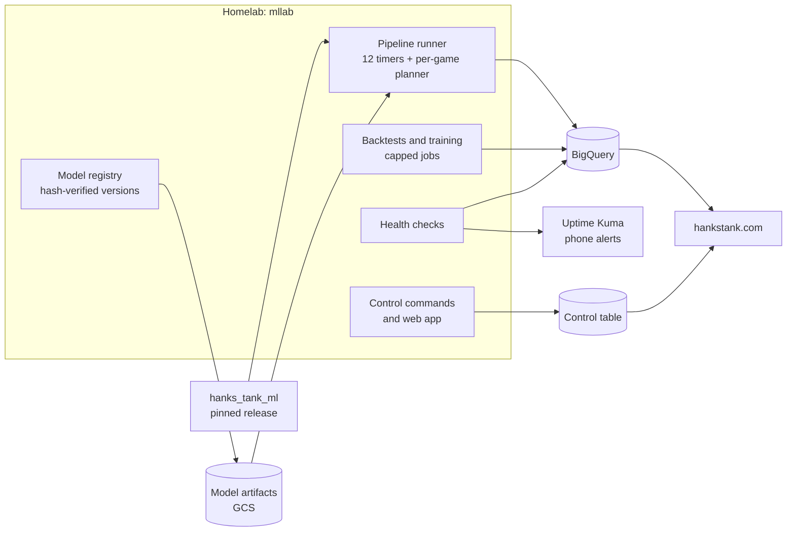

# Hank's Tank Lab (`mllab`)

The model lab and control plane behind [hankstank.com](https://hankstank.com). It runs on my
homelab and does everything around the models: it runs the production prediction pipeline, keeps a
hash-verified registry of every model, backtests candidates against production on the same games,
and lets me pause, pin or hide a model on the live site without a deploy. The models themselves live
in [hanks_tank_ml](https://github.com/elijahcraig45/hanks_tank_ml).

Python, about 8,500 lines and 900 tests. Under the hood: FastAPI, JupyterLab, systemd, BigQuery,
Cloud Storage and Caddy behind Tailscale.



## What it does

- **Runs production.** Twelve scheduled jobs and a per-game MLB planner run as hardened systemd units
  (dedicated user, memory and CPU caps, one run per mode at a time). Each job is `off`, `dry` or
  `live`, and going live is refused unless its Cloud Scheduler twin is paused, so only one system
  ever writes. The jobs moved from Cloud Functions in three staged cutovers, each with a scripted
  readiness check, one verified real run and an automatic rollback (`scripts/cutover_stage*.sh`).
- **Registry.** Immutable, hash-verified model versions with lineage, `prod`/`staging` channels,
  deployment history and model cards. Every production MLB artifact was adopted and checked against
  the live object's hash.
- **Backtests.** Contenders (registry models, walk-forward retrains, probability columns, an
  always-home prior) are scored on the same games with paired-bootstrap confidence intervals.
  Walk-forward is season-aligned, tuning only ever sees earlier seasons, and a parity check confirms
  a registered model reproduces the probability production served.
- **Training and deploys.** Training runs as a capped job and is registered with a hash of its input
  data and its pinned dependency lock. A model swap into the Cloud Function is a dry run by default,
  needs a typed confirmation, backs up the live object first and can be rolled back. The swap was
  rehearsed on real Cloud Storage. A Cloud Run serving image is built by reading which libraries the
  pickle needs without executing it, which took the image from 3.1 GB to 700 MB with prediction
  parity within 5e-5 on 1,957 real games. It has not been deployed for real.
- **Model control plane.** Writes a BigQuery control table (pause, hide, pin, confidence tiers,
  banners, which ranking columns the site shows) that the pipeline, the API and the site all read,
  and all keep working without. Every change is audited and can be reverted.
- **Health checks.** Every few minutes: data freshness, missing or bad predictions, model files
  that don't match their recorded hash, failed live runs, lab disk. Problems push to Uptime Kuma,
  which alerts my phone. Automatic remedies exist but run in dry-run mode until they've earned trust.
- **Guards.** A BigQuery scan cap plus a result-size cap checked before anything downloads, auth
  that fails closed, and a refusal to run with any gcloud account in a blocked domain
  (`MLLAB_BLOCKED_ACCOUNT_DOMAINS`).

## What it found

Real results from using it, all on identical games with paired-bootstrap intervals:

- **The registry copy of the MLB model matches production** to within 5e-5 on 1,957 games (99.9%
  the same pick). No retraining or hyperparameter setting was distinguishable from it, and it was
  not distinguishable from always picking the home team either (+1.6 points, interval −1.3 to
  +4.3). About 2,000 games can only resolve differences of 2–3 accuracy points.
- **NFL 2017–24:** feature models at default settings were not distinguishable from Elo alone;
  tuned XGBoost beat Elo; market columns helped a lot. **College 2019–24:** XGBoost and logistic
  regression both beat Elo in FBS and FCS, and tied each other.
- **The production MLB model file had been overwritten in place,** with no bucket versioning, so
  predictions made before April 29 can't be reproduced. Swaps through the lab now back up first.
- **Silent failures.** The lab's data page found an NFL stats refresh that deleted a season before
  a load that then failed, leaving the site's player page empty for about two weeks while the job
  reported success. A cutover verification caught a college stats load failing on a fractional
  value in an integer column. Both are fixed in the pipeline.

## Using it

```
mllab register|adopt|list|promote ...       registry (immutable, hash-verified versions; prod/staging channels)
mllab job submit|status|logs|cancel ...     run a script or notebook with hard memory/cpu/time caps
mllab bq describe|infer|diff|check ...      table and field checker (exit 4 when a check fails)
mllab backtest run|report ...               side-by-side backtests and parameter sweeps
mllab train run ... / register-job ...      train a model as a job (honest holdout), then register it
mllab runs / card ...                       per-run verdicts; a model's lineage, channels and deploy history
mllab deploy cloudfn-swap|cloudfn-rollback|cloudrun ...   real changes need --confirm
mllab control show|hide|pin|tiers|banner|rankings|revert ...   the site's control table (audited)
mllab health / remedy log|policy ...        health checks and the dry-run remedy log
pipeline-ctl status|set|run ...             the homelab pipeline jobs (off | dry | live)
```

**Table checker.** `mllab bq infer TABLE > spec.yaml`, add rules (key, date column, maximum
staleness, per-column nullable / null rate / min / max), then `mllab bq check spec.yaml`. Schema
checks use free metadata; the data checks are one aggregate query through the cost guard. Real
specs are in `specs/bq/`.

**Backtests.** `mllab backtest run specs/mlb_v10_param_sweep.yaml`, then `mllab backtest report
JOB`. Retrains train only on games dated before the block they predict; `history:` adds older games
as a warm start (`scripts/build_mlb_history.py`). Models run in the environment built from their
registered `requirements.lock`. V8-style ensembles run through `plugins/mlb_v8.py` (verified equal
to production's class), but they can't be backtested from BigQuery: 18 of their inputs are derived
at inference time and stored nowhere. The plugin refuses to run when more than 5% of features are
missing rather than filling zeros.

**Train and version.** `mllab train run specs/train_v11_d2.yaml --wait` trains up to `train_end`,
scores the untouched games after it next to production and a home prior, and writes a V10-style
pickle. `mllab register-job JOB PROJECT MODEL VERSION --parent v10` records it with lineage, its
feature list, a hash of the exact input data and the pinned lock. Use `--channel NAME` and a scratch
`--object` to rehearse a swap without touching the live model object.

**Football.** The pipeline refits its football models every run, so there is nothing to adopt.
`scripts/football/stage_export.sh` stages the pipeline's own code plus the EPA data, and an export
job builds the exact feature frame its trainer uses. Validated against that trainer: logistic
regression reproduces it exactly, XGBoost to within seed noise.

**Data traps** encoded in `sql/mlb_v10_pregame.sql`: several feature rows per game (take the latest
at or before the prediction), `games` holds skeleton and final rows (dedupe on `synced_at`), and
predictions made after first pitch are backfills (excluded).

**Environments.** Each distinct dependency lock gets its own venv. `mllab envs list` shows size and
last use; `mllab envs prune --older-than 30` is a dry run unless `--yes` and never deletes an
environment it can't prove idle.

**Ask Gemini (optional).** `mllab ask "..."`, `%%ask` in notebooks, `--draft-spec KIND --out FILE`
(validated before saving), `--show-context` to see exactly what would be sent: a reference sheet,
the question and opted-in metadata only, never rows, env files or keys. Daily cap
`MLLAB_GEMINI_DAILY_CALLS` (default 50).

## Auth model

- Caddy on `127.0.0.1:8899` calls `/auth` for every request. Browser routes need the owner's
  Tailscale login header, and Jupyter's token is the second factor.
- `/api/*` also needs `X-Mllab-Secret`, for the CLI and scripts.
- A local process can spoof the Tailscale header on browser routes, so the Jupyter token is the real
  barrier there.
- Auth fails closed while `MLLAB_ALLOWED_LOGIN` is empty.

## Layout

| Path | What's there |
|---|---|
| `src/mllab/` | Registry, BigQuery guard, jobs, backtests, training, control, health, remedies, CLI |
| `src/mllab/pipeline/` | The production pipeline runner, per-game planner, stager and `pipeline-ctl` |
| `src/mllab/webapp/` | The control app (lab home page) |
| `host/` | systemd units, Caddy config, installers, backup, credential maintenance |
| `specs/`, `sql/`, `catalog/` | Backtest and training specs, data queries, the table catalog |
| `notebooks/` | Starter notebooks seeded into the lab's JupyterLab |
| `docs/` | The control contract, control app, homelab pipeline and cutover runbooks |
| `scripts/` | Deploys, cutovers, data exports, and `publish_public.py` |

## Development

```
python3 -m venv .venv && .venv/bin/pip install pytest pandas duckdb pyarrow google-cloud-bigquery fastapi httpx
PYTHONPATH=src .venv/bin/pytest -q
```

Install on a host: read `host/install.sh` first and always run `sudo ./install.sh --dry-run` before
the real run. The pipeline layer installs separately from `host/pipeline/install.sh`.

This public repo is a cleaned snapshot of a private working repo, made with
`scripts/publish_public.py`: host names, addresses and accounts are replaced with placeholders.

## License

MIT
